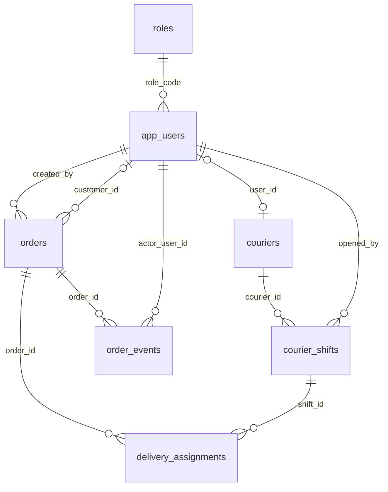
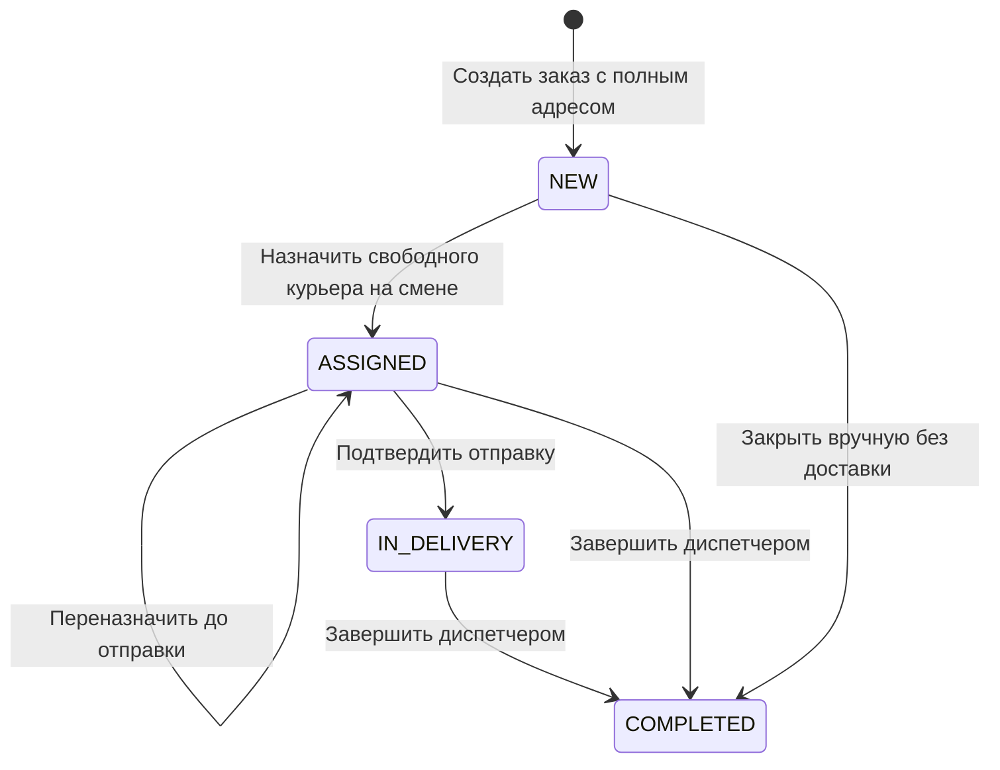
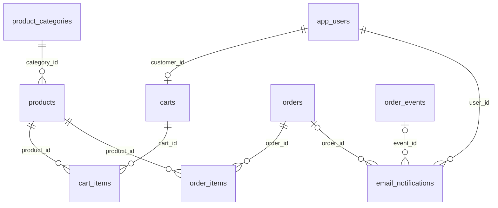

# База данных приложения «КСтолу»

Статус: модель перенесена в Spring-проект: JPA-сущности, репозитории, миграция Flyway и транзакционный сервис. Интерфейс временно отложен по указанию пользователя. Локальный PostgreSQL 18 запущен через Docker Compose; начальная миграция применена, запуск приложения с этой БД проверен. Для автоматических тестов отдельно используется временный PostgreSQL.

## Основание и границы

Основание — фотография задания и уточнения пользователя в `ТРЕБОВАНИЯ_КУРСОВОЙ.md`. Обязателен Spring; PostgreSQL в задании не указан и выбран здесь как предлагаемая СУБД. Для проекта подходят связи, транзакции, ограничения и частичные уникальные индексы PostgreSQL.

Предметная область по уточнению пользователя — доставка готовой еды. Исходная тема задания на фотографии — «Сервис доставки продуктов»; это различие не скрываем при подготовке пояснительной записки.

Первый этап: ручное создание заказов, полный адрес, общий список курьеров, смены, назначение, отправка и завершение заказа диспетчером. Меню, клиентское оформление, письма и экспорт отчетов остаются следующими этапами. Ниже спроектировано как текущее ядро, так и его расширение под задание.

Диспетчер — это менеджер (`MANAGER`) из задания. Пятую роль не добавляем. Остальные роли: `ADMIN`, `CLIENT`, `COURIER`. В первом варианте у учетной записи одна роль; несколько ролей одному пользователю сейчас не требуются.

## Связи первого этапа

Диаграмма показывает основные связи. Дополнительные ссылки на пользователей, подтверждающих отправку, завершение и закрытие смены, перечислены в SQL. Для каждой операции приложение обязано проверять роль и активность пользователя.

## Таблицы первого этапа

| Таблица | Что хранит | Основные поля |
|---|---|---|
| `roles` | Четыре роли из задания | `code`, `name` |
| `app_users` | Учетные записи и доступ | `id`, `role_code`, `email`, `password_hash`, `display_name`, `is_active`, `created_at` |
| `couriers` | Постоянный список курьеров | `id`, необязательный `user_id`, фамилия, имя, отчество, `phone`, `age_years`, `age_recorded_on`, `is_active` |
| `courier_shifts` | Каждый выход и завершение смены | `id`, `courier_id`, `started_at`, `ended_at`, `opened_by`, `closed_by` |
| `orders` | Заказ, адрес и состояние | Внутренний `id`, `order_number`, получатель и телефон, полный адрес `address_text`, тип `address_type`, `delivery_due_at`, комментарий, статус, автор и данные завершения |
| `delivery_assignments` | История назначений курьеров | `order_id`, `shift_id`, кто и когда назначил, отправил и освободил; причина освобождения |
| `order_events` | История действий с заказом | `order_id`, тип события, старый/новый статус, исполнитель, время, примечание |

Полные поля, типы, ключи и ограничения находятся в [schema.sql](schema.sql). Это справочная копия: источником схемы в приложении служит `src/main/resources/db/migration/V1__delivery_core.sql`. Flyway применяет миграцию при запуске, а Hibernate только проверяет модель (`ddl-auto=validate`). Внутренние ключи — `bigint`, даты событий — `timestamptz`. В интерфейсе даты показываем в `Europe/Moscow`; храним дату вместе со временем, а не только «14:30».

## Важные решения

### Учетная запись и курьер — разные сущности

Менеджер может добавить курьера по ФИО, телефону и возрасту, не создавая ему сразу логин. Поэтому `couriers.user_id` допускает `NULL`, а назначенные учетные записи не повторяются. Когда реализуем кабинет курьера из задания, профиль связывается с активной учетной записью роли `COURIER`. Проверка роли при связывании выполняется сервисом.

Пароли хранятся только в виде адаптивного хеша, создаваемого Spring Security PasswordEncoder. SQL не содержит готовых паролей или учетных записей администратора. Корректность email проверяется в приложении, SQL дополнительно запрещает пустые значения и повторы без учета регистра.

Телефоны перед сохранением приводим к формату `+` и цифры, например `+79001234567`; форматирование скобками остается в интерфейсе. У курьеров телефон уникален. На минимальный возраст работника отдельного требования пока нет: диапазон 1–120 — техническая проверка ввода, а не согласованный возраст допуска к работе.

Пользователь просил ввод возраста. Поэтому сохраняем `age_years` и дату, на которую его указали, `age_recorded_on`. Это возраст при заполнении, он не становится актуальным автоматически каждый год. Если позже согласуем дату рождения, заменим ввод и будем вычислять возраст; выдумывать дату рождения по возрасту нельзя.

### Курьер, смена и занятость

Курьер существует независимо от смен. Новая запись в `couriers` не создает смену. «Выйти на смену» добавляет `courier_shifts`, «Завершить смену» заполняет `ended_at` и `closed_by`.

Отдельные поля «свободен/занят» в курьере не храним, чтобы они не расходились с заказами:

- вне смены — нет смены с `ended_at IS NULL`;
- на смене и свободен — открытая смена есть, активного назначения нет;
- занят — у открытой смены есть назначение с `released_at IS NULL`.

Для текущего макета принята модель «один активный заказ на курьера». Задание допускает список заказов, но не требует нескольких одновременных доставок. Завершенные назначения остаются в истории. Если понадобятся маршруты с несколькими заказами, это будет отдельное изменение модели и ограничения занятости.

### Заказ и полный адрес

Заказ сейчас может создаваться менеджером без зарегистрированного клиента и без позиций меню. `created_by` обязателен, `customer_id` пока необязателен. Позже клиентское оформление заполнит `customer_id`.

По последнему уточнению пользователя отдельную таблицу адресов исключили. Полный адрес одной строкой (`address_text`, до 500 символов) и тип (`address_type`) хранятся непосредственно в `orders`. Это семь таблиц ядра. Адрес сохраняется вместе с заказом, чтобы его можно было открыть после перезапуска приложения. Редактирование профиля клиента в будущем не меняет адрес старой доставки.

Пользователь выбирает `APARTMENT` (квартира) или `PRIVATE_HOUSE` (частный дом) и вводит полный адрес в одну строку. Например: «г. Владимир, ул. Мира, д. 36, корп. 1, кв. 42, подъезд 3, этаж 7». Для частного дома: «г. Владимир, ул. Лесная, д. 12А». SQL проверяет непустую строку и допустимый тип. Наличие конкретного номера квартиры внутри свободного текста автоматически не гарантируется: полноту проверяет оператор. Комментарий остается отдельным полем для дополнительных инструкций. Ранее показанный макет с раздельными полями пока не обновляется: работа над ним приостановлена пользователем.

### Восьмизначный номер

`orders.id` — внутренний ключ, а `order_number` — номер для диспетчера и поиска. Номер состоит из восьми цифр, первая от 1 до 9: диапазон 10000000–99999999. Храним строкой, поскольку это идентификатор, а не величина для вычислений.

Номер случайно генерирует Java-сервис. Уникальность обеспечивает `UNIQUE` в БД, а не предварительный запрос «есть ли такой номер». При совпадении кандидат повторяется с другим номером. Вариант для реализации: `INSERT ... ON CONFLICT (order_number) DO NOTHING RETURNING id`; если строка не вставлена, повторить генерацию ограниченное число раз, затем вернуть понятную ошибку.

Требование пользователя — не повторять активные номера. Предлагаемое более строгое правило, уже показанное в макете: не повторять и сохраненные завершенные номера. Тогда поиск по номеру всегда однозначен. Номера завершенных заказов не освобождаем. Это отдельное проектное решение, а не буквальное требование задания.

Поиск по полному номеру использует уникальный индекс. Частичный поиск, показанный в макете, допустим для небольшого объема; отдельную оптимизацию под подстроки пока не добавляем.

### Состояния заказа

`COMPLETED` означает «закрыт», а не обязательно «фактически доставлен»: в текущем макете диспетчер может вручную закрыть заказ даже до отправки. Такие случаи различаются по наличию `dispatched_at` и событиям истории. В отчете нельзя автоматически считать все закрытые заказы успешными доставками. При согласовании отчетов имеет смысл выделить результат доставки или отмену отдельным полем/статусом.

Подтверждение в интерфейсе само по себе не меняет БД. Подтвержденная отправка одной транзакцией устанавливает `IN_DELIVERY`, записывает `dispatched_at/dispatched_by` и событие `DISPATCHED`.

Завершение одной транзакцией устанавливает `COMPLETED`, сохраняет автора и время, закрывает активное назначение с причиной `COMPLETED`, добавляет событие. Смена остается открытой. Менеджер затем отдельно закрывает смену или дает новый заказ.

Переназначение до отправки закрывает предыдущее назначение с причиной `REASSIGNED` и создает новое. Старого курьера не теряем из истории.

## Что обеспечивает БД, а что Spring

| Проверка | Место выполнения |
|---|---|
| Восемь цифр и уникальность номера, ссылки на существующие записи | Ограничения БД |
| Не более одной открытой смены курьера | Частичный уникальный индекс |
| Не более одного активного назначения на заказ и на смену | Два частичных уникальных индекса |
| Непустой адрес, допустимый тип адреса и статусы | `CHECK` и `NOT NULL` |
| Только активный курьер и активный пользователь; допустимая роль автора | Spring-сервис и авторизация |
| Назначение только в открытую смену; закрытие смены без активного заказа | Spring-сервис в транзакции с блокировками |
| Согласованность статуса заказа, назначения и журнала | Spring-сервис: все изменения одной транзакцией |
| Заказ содержит непустой адрес; текст достаточно полный для доставки | БД проверяет непустую строку, оператор проверяет содержание |
| Последовательность переходов и запрет переназначения в пути | Spring-сервис |

`CHECK` не проверяет произвольные другие строки и таблицы. Поэтому SQL-файл сам по себе не заменяет бизнес-логику. Нужны `@Transactional` и блокировки строк: параллельные действия двух диспетчеров не должны одновременно назначать и закрывать одну смену.

Общий порядок блокировок для операций, затрагивающих заказ и смены: сначала заказ, затем затрагиваемые профили курьеров в порядке `id`, затем смены в порядке `id`. Открытие/закрытие смены блокирует профиль курьера перед проверкой смены. После получения блокировок условия проверяются повторно. Предлагаемый режим — READ COMMITTED с явными блокировками; уникальные индексы остаются дополнительной защитой от гонок. Конкретный код и тесты конкурентных операций — этап реализации.

Профили и учетные записи деактивируем через `is_active`, заказы и события сохраняем для истории. Деактивация курьера не должна обходить проверку активных заказов/смен. Каскадное удаление рабочих записей не предусмотрено.

## Расширение под полное задание

Следующие шесть таблиц относятся к последующим этапам. В SQL первого этапа их пока нет, чтобы не начать работу с меню без уточнений пользователя.

| Таблица | Поля и связи будущего этапа | Требование задания |
|---|---|---|
| `product_categories` | `id`, `name`, `is_active`; категория содержит блюда | Управление категориями |
| `products` | `id`, `category_id`, `name`, `description`, `price numeric(12,2)`, `is_available`, `is_active` | Каталог, поиск и фильтрация; в интерфейсе это блюда |
| `carts` | `id`, уникальный `customer_id → app_users`, `updated_at` | Корзина клиента |
| `cart_items` | `cart_id`, `product_id`, `quantity`; уникальная пара корзина–блюдо | Состав корзины |
| `order_items` | `id`, `order_id`, `product_id`, `product_name_snapshot`, `unit_price_snapshot numeric(12,2)`, `quantity` | Состав заказа и денежные сводки |
| `email_notifications` | `id`, `user_id`, `order_id`, `event_id`, email получателя на момент отправки, тип, статус, число попыток, времена создания/отправки, последняя ошибка | Уведомления по электронной почте |

Цены храним десятичным типом, количество — положительным целым. Название и цену блюда копируем в позицию заказа: изменение меню не переписывает историю покупок. Для клиентского оформления сервис потребует хотя бы одну позицию; для текущего ручного диспетчерского заказа меню остается необязательным. Будущая миграция явно добавит источник оформления (`MANAGER`/`CLIENT`) и правила состава заказа.

Сводные отчеты формируются запросами из заказов, смен, назначений и событий; Excel/PDF создается приложением. Отдельная таблица «отчет» не требуется, пока не согласовано хранение сформированных файлов. Длительность смены, число закрытых заказов, время от назначения до отправки и до закрытия можно получить из ядра. Выручку без состава заказа и цен рассчитывать нельзя.

Письма следует ставить в очередь в той же транзакции, что и соответствующее событие, а отправлять после фиксации транзакции с повторными попытками. Сохраненные события также позволят реализовать отображение этапов доставки клиенту и курьеру.

Адаптивность интерфейса не создает отдельные таблицы. Модульные тесты бизнес-логики и клиентская валидация не заменяют ограничения БД.

## Проверки перед подключением

1. Применить `schema.sql` к новой тестовой PostgreSQL; откатить все изменения при ошибке.
2. Проверить запрет повторных номеров, двух открытых смен и двух активных назначений на одну смену/заказ.
3. Проверить отклонение пустого/пробельного адреса и недопустимого типа; проверить сохранение полного текста для квартиры и частного дома.
4. В сервисных тестах проверить ручную регистрацию вне смены, открытие смены, назначение, подтвержденную отправку, завершение заказа и отдельное завершение смены.
5. Отдельно проверить конкурентные назначение/закрытие смены и повторное нажатие завершения.
6. Проверить, что неуспешная операция не оставляет заказ без адреса, событие без изменения заказа или незакрытое назначение после завершения.
7. Для будущих ролей проверить доступ только к своим заказам и назначенным доставкам.

Реализация находится в пакете `ru.komissarov.grocerydelivery.delivery`. Миграция и соответствие JPA проверяются на настоящем временном PostgreSQL 14.22 через Zonky Embedded Postgres. Отдельно проверяются рабочий цикл, история переназначений, коллизии номеров, ограничения БД, идемпотентное завершение и конкурентные назначение/закрытие смены. Для постоянного локального сервера используется `compose.yaml` с PostgreSQL 18. База запущена, миграция V1 применена, четыре роли созданы. Spring и Docker Compose читают пароль из локального `.env`, исключенного из Git. Веб-контроллеры и аутентификация еще не реализованы; операции доступны на уровне внутреннего сервиса, который проверяет роль переданного автора. Подключаемый позже веб-слой обязан брать автора из аутентифицированного пользователя.

## Технические основания

- [PostgreSQL: ограничения](https://www.postgresql.org/docs/current/ddl-constraints.html) — ключи, проверки и ограничения межстрочных проверок через CHECK.
- [PostgreSQL: частичные индексы](https://www.postgresql.org/docs/current/indexes-partial.html) — уникальность только среди открытых смен и активных назначений.
- [PostgreSQL: блокировки](https://www.postgresql.org/docs/current/explicit-locking.html) — защита согласованных операций при параллельной работе.
- [PostgreSQL: INSERT / ON CONFLICT](https://www.postgresql.org/docs/current/sql-insert.html) — обработка совпадения случайного номера.
